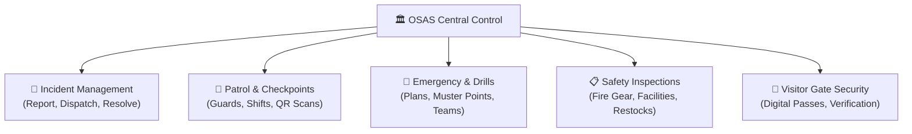
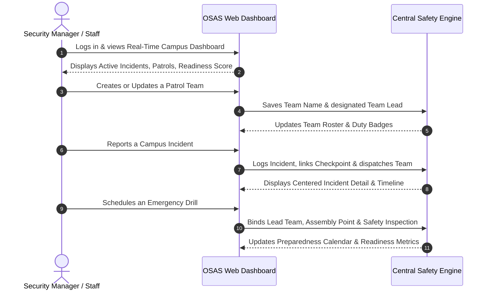

# OSAS Campus Safety & Security System
## Executive Operations & System Walkthrough Guide

---

## 1. Executive Summary

The **Office of Student Affairs and Services (OSAS) Safety & Security System** is an integrated management platform designed to protect students, faculty, staff, and campus visitors. 

In simple terms, think of OSAS as the **central control room** for the entire university. It brings together security personnel, physical checkpoints, emergency protocols, and daily hazard checks into a single, coordinated dashboard. Instead of relying on handwritten logbooks, scattered paper reports, or verbal radio messages, all security operations are logged, tracked, and updated in real time.

---

## 2. Core Pillars of the System

### Pillar 1: Patrol Teams & Personnel
* **What it is:** The organization of on-duty security personnel into structured teams (e.g., Team Alpha, Team Bravo).
* **Key Roles:** Every team has a designated **Team Lead** (the supervisor or lead guard on duty) and assigned guard members.
* **Operational Value:** Administrators know exactly who is on duty, which shift is active, and who is accountable for specific areas of the campus at any given moment.

---

### Pillar 2: Security Checkpoints
* **What it is:** Strategic physical locations established throughout the university (e.g., Main Gate, Science Wing, Library, Student Center).
* **How it works:** Each checkpoint has a unique digital identifier. When a guard patrols an area, they scan the checkpoint using their device.
* **Operational Value:** This confirms physical guard presence and ensures no critical area of the campus is overlooked during daily shifts.

---

### Pillar 3: Incident Response & Dispatch
* **What it is:** The process of capturing, investigating, and resolving security and safety concerns (such as a medical emergency, trespasser, chemical spill, or property damage).
* **How it works:**
  1. An incident is reported and logged with its location, severity level, and description.
  2. The system allows dispatchers to immediately assign a **Patrol Team** and link the nearest **Checkpoint**.
  3. The response team investigates, takes corrective measures, and logs updates into an auditable timeline until the incident is formally resolved and closed.
* **Operational Value:** Accelerates response times and maintains a tamper-evident audit record for university governance and compliance.

---

### Pillar 4: Predictive Patrol Routing & Risk Scoring
* **What it is:** An operational tool that helps security managers decide where guards should focus their attention.
* **How it works:** The system analyzes recent security reports, unmonitored zones, and historical safety events to highlight higher-risk zones. It then suggests an optimal sequence of checkpoints for the next patrol round.
* **Operational Value:** Transforms campus security from a passive, routine walkthrough into an intelligence-driven, proactive safety posture.

---

### Pillar 5: Emergency Drills & Evacuation Planning
* **What it is:** The coordination of university-wide safety drills (Fire, Earthquake, Lockdown, Medical) and approved evacuation routes.
* **How it works:** 
  * Each drill is scheduled in the university calendar.
  * A **Lead Response Team** is designated to supervise evacuation and perimeter control.
  * An **Assembly Checkpoint** (such as the Grandstand or Main Plaza) is selected as the designated muster point.
  * A **Readiness Inspection** is linked to confirm that emergency exits, alarms, and fire extinguishers are verified beforehand.
* **Operational Value:** Ensures high institutional readiness and compliance with national disaster risk reduction standards.

---

### Pillar 6: Safety Inspections & Compliance
* **What it is:** Preventive facilities and hazard assessments conducted on buildings, rooms, and equipment.
* **How it works:** Inspectors examine fire safety systems, electrical panels, lighting, and first-aid supplies, logging findings and corrective actions directly into the register.
* **Operational Value:** Prevents accidents before they occur and guarantees that safety equipment remains certified and fully operational.

---

### Pillar 7: Visitor Pass & Gate Control
* **What it is:** The registration and tracking of external visitors entering the campus.
* **How it works:** Guests are issued a time-bound digital QR pass. Guards at the gate scan the pass upon entry and again upon exit.
* **Operational Value:** Prevents unauthorized campus entry, discourages trespassers, and provides an immediate headcount of external visitors during emergencies.

---

## 3. Step-by-Step Operational Walkthrough

Here is how an authorized user accomplishes key daily tasks within the interface:

---

### Scenario A: Registering a Patrol Team and Assigning a Lead
1. Navigate to **"Teams & Checkpoints"** on the left navigation panel.
2. Click the **"Assign Route / Add Team"** button at the top right of the section.
3. In the modal dialog:
   * **Team Name:** Enter the identifier for the squad (e.g., `Team Charlie` or `Night Patrol Unit`).
   * **Team Lead:** Enter the full name of the assigned supervisor or lead officer (e.g., `Officer R. Dela Cruz`).
   * **Assignment:** Select the shift category (`Active patrol shift`, `Predictive route`, or `Standby`).
4. Click **"Save Assignment"**.
5. **Result:** The team appears in the registry with their specified lead name, duty badge, and active incident counter.

---

### Scenario B: Logging and Managing an Incident
1. Navigate to **"Incidents"** on the left navigation panel.
2. Click **"+ Log Incident"**.
3. Fill in the required operational details:
   * **Title:** A concise description (e.g., `Unauthorized entry attempt at rear gate`).
   * **Checkpoint:** Select the nearest physical checkpoint from the dropdown list.
   * **Incident Type:** Choose the category (`Security`, `Safety Hazard`, `Medical`, `Fire`, etc.).
   * **Priority:** Set the urgency (`Low`, `Medium`, `High`, `Critical`).
   * **Assign Patrol Team:** Select the available response unit.
4. Click **"Create Incident"**.
5. To view or update the report:
   * Click **"View Incident"** on the incident card.
   * A cleanly formatted, centered window opens displaying location details, linked checkpoints, and chronological timeline events.
   * Change status to `Responding` or `Resolved`, record investigation directives in the notes field, and click **"Save & Dispatch"**.

---

### Scenario C: Scheduling an Emergency Evacuation Drill
1. Navigate to **"Emergency Plans"** on the left navigation panel.
2. Click **"+ Schedule Drill"** on the Emergency Drills panel.
3. In the scheduling dialog:
   * **Drill Title:** Enter the exercise name (e.g., `Semester 1 University Earthquake Drill`).
   * **Drill Type:** Select `Earthquake`, `Fire`, `Lockdown`, or `Medical`.
   * **Lead Response Team:** Select the patrol team responsible for crowd control and evacuation clearance.
   * **Assembly / Staging Checkpoint:** Select the official evacuation muster point (e.g., `Grandstand Open Grounds`).
   * **Linked Readiness Inspection:** Choose the pre-drill inspection certifying exit clearances.
   * **Date & Time:** Set the scheduled execution window.
4. Click **"Save Drill"**.
5. **Result:** The drill is registered in the university preparedness calendar, automatically reflecting the assigned team, assembly point, and certification link.

---

### Scenario D: Conducting a Preventive Safety Inspection
1. Navigate to **"Emergency Plans"** or **"Inspections"**.
2. Click **"+ Schedule Inspection"**.
3. In the inspection dialog:
   * **Campus Zone:** Enter or select the building/area to inspect.
   * **Inspected Checkpoint:** Select the physical station being assessed.
   * **Inspection Type:** Select `Fire safety`, `Access control`, `First aid supplies`, or `General safety`.
   * **Assigned Inspection Team:** Select the team tasked with carrying out the audit.
   * **Scheduled Date:** Select the due date.
4. Click **"Save Inspection"**.
5. **Result:** The inspection joins the OSAS review queue, tracking compliance until marked complete.

---

## 4. Key Benefits for Stakeholders

| Stakeholder | Practical Benefit |
| :--- | :--- |
| **University Leadership & Deans** | Full governance oversight, instant readiness score, and auditable records for regulatory and accreditation standards. |
| **Security Directors & Supervisors** | Real-time visibility into on-duty guards, active incidents, and automated risk-weighted patrol recommendations. |
| **Faculty, Staff & Students** | Rapid response to emergencies, validated safe evacuation paths, and strict gate accountability. |
| **Non-Technical Staff** | Clean, visual interfaces with clearly labeled options, guided dropdowns, and centered, easy-to-read modals. |

---

*Document Version: 2.0 (Executive Edition)*  
*Prepared for: OSAS Campus Safety & Security Operations*

